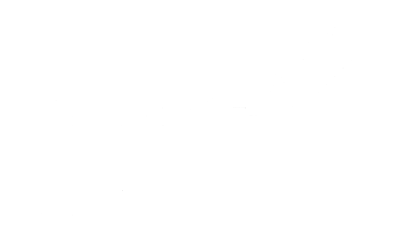

<div align="center">

<table width="160">
<tr><td align="center">



</td></tr>
</table>

# ChemVision

**化学结构解析、可视化编辑与 AI 辅助学习工具**

以 SMILES 衔接化学数据库、结构编辑器与教学流程的 Flutter / Dart 客户端。

[](LICENSE)
[](pubspec.yaml)
[](pubspec.yaml)
[](#本地安装与运行)
[](docs/competitions/openatom-2026/README.md)

[核心能力](#核心能力) · [本地运行](#本地安装与运行) · [验证](#验证) · [架构](#架构) · [数据与隐私](#数据与隐私) · [开源与贡献](#开源与贡献)

</div>

当前版本以 [pubspec.yaml](pubspec.yaml) 为准（`1.0.64+65`）。开放原子 2026 参赛材料见 [工作包](docs/competitions/openatom-2026/README.md)。

---

## 核心能力

| 能力 | 说明 |
| --- | --- |
| 名称 → 结构 | 中文经 LLM 规范化后查询 PubChem，OPSIN 回退；英文名称可直接走化学数据库 |
| 结构显示与编辑 | SmilesDrawer 渲染，Ketcher 编辑器嵌入 WebView / iframe |
| 图像 → SMILES | DECIMER OCSR 客户端，可自部署 Python 包装服务 |
| SMILES 检查 | 括号、标记、环闭合等启发式校验 |
| 收藏 / 历史 / 学习记录 | Hive 本地存储；模型配置与结构缓存使用 SharedPreferences |
| 教学 Agent | 任务规划 → 工具注册表 → 知识点 → LLM；支持讲解、辅导、诊断、规划、出题、错因分析与对话 |
| 知识库 | 31 个手工知识点，按 SMILES 子串与名称关键词匹配 |
| 反应补全 | 本地反应库，可选 Embedding 检索与 LLM 补全 |
| 账号与托管 AI | 可选 Supabase Auth、RLS 与 Edge Functions |
| 语音输入 | 通过 `speech_to_text` 调用系统或浏览器语音服务 |

## 本地安装与运行

### 环境准备

| 项目 | 要求 |
| --- | --- |
| 工具链 | Flutter `3.41.8`（stable）、Dart `3.11.5` |
| Dart SDK | `>=3.9.0 <4.0.0`，见 [pubspec.yaml](pubspec.yaml) |
| Web | 当前首选运行与验证目标 |
| Windows | 需 Visual Studio C++ 工具链 |
| Android | JDK 17、最低 API 28、arm64 |
| iOS | 需在 macOS 环境构建 |

首次运行需联网获取依赖。

### 启动 Web 客户端

```sh
flutter pub get
flutter run -d chrome
```

### 配置 AI 与图像识别

未配置 Supabase 也可进入访客界面。使用自带 AI 时：

1. 在设置页切换“自带 API”
2. 填写 OpenAI 兼容 Base URL、模型 ID 与密钥
3. 图像识别另配置 DECIMER 端点

请勿将 API Key 写入代码或构建参数。

本地开发代理：

```sh
node tools/openai_compatible_proxy.js
```

默认监听 `127.0.0.1:8787`，可用 `AI_TARGET` 指定上游 origin。

### 构建各平台产物

```sh
flutter build web --release
flutter build windows --release
flutter build apk --release
```

Web 产物在 `build/web/`，请用 HTTP 静态服务打开。Ketcher / SmilesDrawer 随 Flutter assets 打包。Android 构建与拆包记录见 [验证记录](docs/competitions/openatom-2026/13-current-removal-status.md)。

### 可选后端

账号与托管 AI 配置见 [后端指南](docs/backend-auth.md)。前端仅注入 Supabase URL / publishable key；service-role 与上游 AI 密钥放在服务端。DECIMER 部署入口为 `tools/decimer_hf_space/Dockerfile`。

## 验证

```sh
flutter analyze --no-fatal-infos
flutter test --reporter expanded
python tools/competition_audit.py --history --output audit.json
flutter build web --release
```

仓库提供 [Quality checks](.github/workflows/quality.yml) 与 [Flutter Build & Deploy](.github/workflows/flutter-build.yml)：前者检查 PR / 参赛分支，后者在 main 推送时递增版本、部署 Pages 并发布 Release。

## 架构

```text
Flutter UI / Riverpod
  ├─ NameToStructureService → 中文 LLM 规范化 → PubChem → OPSIN
  ├─ ImageStructureService → DECIMER → 轻量 SMILES 检查 → PubChem 候选
  ├─ Ketcher / SmilesDrawer → SMILES / SVG → 收藏与历史
  └─ TaskPlanner → AgentOrchestrator → ToolRegistry
       ├─ OCSR / 化合物查询 / 手工知识库
       ├─ ModelRouter → OpenAI 兼容 API / Supabase AI
       └─ LearningRecordService → 画像汇总 → 诊断与规划上下文
```

模块与接口详见 [参赛架构文档](docs/competitions/openatom-2026/04-architecture.md)。

## 数据与隐私

| 服务 | 可能涉及的数据 |
| --- | --- |
| OCSR | 图片 |
| 系统或浏览器语音服务 | 音频 |
| PubChem / OPSIN | 名称或结构 |
| 模型服务 | 问题、结构、工具结果、对话历史与学情汇总 |
| 账号服务 | 邮箱 / 第三方身份 |

本地保存的 API Key 存放在 SharedPreferences。建议使用获授权样本，并遵守各服务方条款。

## 开源与贡献

自有代码采用 MIT，见 [LICENSE](LICENSE)。第三方依赖与来源说明见 [NOTICE](NOTICE) 及 [治理计划](docs/competitions/openatom-2026/09-governance-roadmap.md)。

贡献步骤见 [贡献指南](CONTRIBUTING.md)。