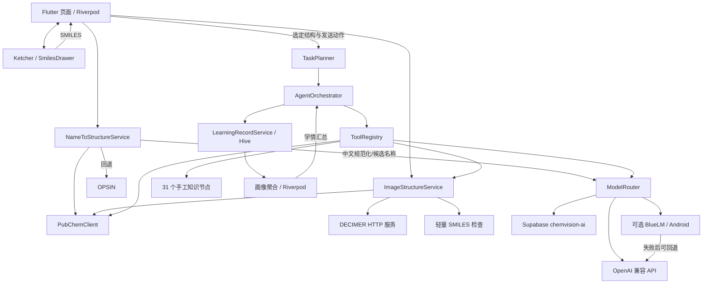

# 系统架构、接口与部署

## 模块与数据流

注：上图最后一条为“云端回退”的概念表达；实际 `ModelRouter` 会先判断托管设置，可能回退 Supabase，也可能回退自带 API，并非固定同一服务。

## 代码职责

| 代码 | 职责 |
| --- | --- |
| `lib/main.dart` | 启动、本地存储初始化、Provider 注入与用户切换 |
| `lib/services/real_structure_service.dart` | 名称规范化、数据库/OPSIN 查询、反向命名 |
| `lib/services/structure_cache_store.dart` | 模式隔离缓存；反向 SMILES 保留大小写、v2 命名空间 |
| `lib/services/openai_compatible_client.dart` | Chat/多模态/Embedding 协议与重试 |
| `lib/services/model_router.dart` | 托管/自带 API/端侧路径选择 |
| `lib/services/agent/*` | 固定计划、工具调用、数据槽位、上下文与结果汇总 |
| `lib/services/chemical_knowledge_base.dart` | 手工节点和子串/关键词匹配 |
| `lib/providers/learning_profile_provider.dart` | 依学习记录计算启发式掌握度；存在本轮开始前的用户改动，已保留 |
| `assets/web/ketcher/` | 第三方编辑器及本地适配；原入口有两个失效引用，本轮修正 |
| `supabase/migrations/`、`supabase/functions/` | 账号资料、Owner 判定、配额预留与代理 |

## AI 实际调用

Chat 接口为 `POST <base>/chat/completions`（通常 Base URL 含 `/v1`）；messages 内发送用户文本，多模态内容可带图片 data URI，非流式响应取 `choices[0].message.content`。Embedding 为对应 `/embeddings`，用于反应库的可选检索。Base URL 与实际模型由设置决定，不应在材料中编造固定模型参数。

托管 AI 由 `SupabaseAuthService` 携带当前访问令牌调用 `chemvision-ai`；Edge Function `getUser` 识别用户，Owner RPC 决定管理权限，数据库 RPC 预留/结算用量，服务器持有上游密钥。源码硬编码托管模型标识 `deepseek-flash`，是否在上游可调用需要真实部署验证；不代表自有模型。默认普通账号配额为总计 5 次，不是每日 5 次。

端侧 BlueLM 通过 Android MethodChannel/Kotlin/AAR；没有在本次环境验证推理或获得再分发许可。服务失败可能进入云端回退，不能标为强制离线。

## 外部接口契约（源代码层面）

| 接口 | 输入 | 输出/鉴权 | 本轮验证边界 |
| --- | --- | --- | --- |
| PubChem PUG REST | 英文名称或 SMILES | 分子属性 JSON | 公共服务实测记录见证据；无私密输入 |
| OPSIN | 英文化学名 | SMILES 等 JSON；Web 需代理 CORS | 代码回退存在，实际可用性单独记录 |
| DECIMER `POST /process_image` | multipart 字段 `image` | 纯文本 SMILES；空/INVALID 视为失败 | 客户端+Python 包装器存在，真实推理未验证 |
| DECIMER `GET /health` | 无 | 服务状态 | 健康不等于推理正确或模型已完成冷启动 |
| Supabase `admin-users` | POST，Bearer、页码/页大小 | Owner 专用用户列表 | 仅审阅代码，未读取真实账号 |
| Supabase `chemvision-ai` | POST，Bearer、prompt/可选图片 | 模型响应/配额错误 | 仅审阅代码，未产生云端变更 |

详细账号部署见 [backend-auth.md](../../backend-auth.md)。模型服务本身、PubChem/OPSIN/DECIMER 由各自运营者维护；仓库中忽略的 Cloudflare Worker 不属于可复现源码。Web OPSIN 默认代理使用固定地址，交付时需说明运行依赖或自行提供对应代理。

## 本地数据与隐私

Hive 按本地用户标识区分学习/收藏等 box；SharedPreferences 保存模型密钥、结构缓存等，未使用专用安全存储。学情摘要发送模型时包含知识点与统计，不包含本轮新增摘要中的 userId/时间戳；问题、对话、其他工具结果仍可能含用户输入，不能称全面脱敏。

切换本地用户不等于 Supabase 云账号完全隔离，SharedPreferences 配置/结构缓存为应用级别；正式部署须评估共享设备场景。清除本地数据不会删除服务商已处理的数据或云账号。

## 复现和构建

使用根 README 命令与锁文件。Web 先构建，再用 `python -m http.server 8080 --directory build/web --bind 127.0.0.1`，在 `http://127.0.0.1:8080` 验证；该命令是本地启动示例，非已部署服务证明。自带模型需 CORS、可用模型和授权专用密钥。

最终验收必须从待提交 Git 版本干净检出执行，而非只验证混有未提交页面/素材的当前目录。Android 签名和厂商 SDK 授权未完成时优先交付已验证的 Web 源码与产物，不能擅自删除现有 Android 功能。
